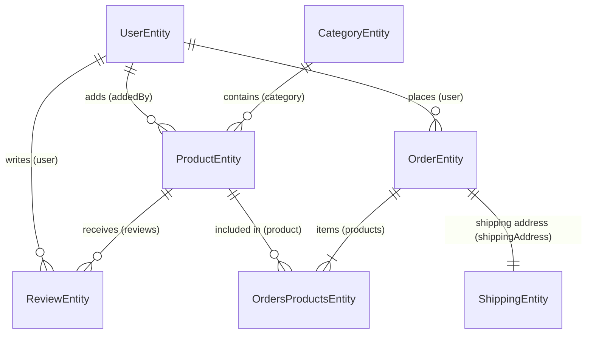

# 🛒 NestJS E-Commerce Backend REST API — Detailed Development & Method Guide

This document is prepared to explain completely and in detail the **chronological development order, all modules, service methods, HTTP routes, and architectural decisions** of an e-commerce backend application developed using NestJS, TypeORM, and PostgreSQL (Neon Cloud Database).

---

## 📋 TABLE OF CONTENTS

1. [Project Architecture and Technology Stack](#1-project-architecture-and-technology-stack)
2. [Database Schema and Relationship Map](#2-database-schema-and-relationship-map)
3. [Step-by-Step Chronological Development Flow](#3-step-by-step-chronological-development-flow)
   - [Step 1: User Management and Authentication (Users & Auth)](#step-1-user-management-and-authentication-users--auth)
   - [Step 2: Category Management (Categories)](#step-2-category-management-categories)
   - [Step 3: Product Management and Complex Queries (Products)](#step-3-product-management-and-complex-queries-products)
   - [Step 4: Product Reviews and Ratings (Reviews)](#step-4-product-reviews-and-ratings-reviews)
   - [Step 5: Order, Shipping, and Inventory Management (Orders & Shipping)](#step-5-order-shipping-and-inventory-management-orders--shipping)
4. [Utility Mechanisms (Guards, Decorators, Interceptors)](#4-utility-mechanisms-guards-decorators-interceptors)
5. [Advanced Architectural Solutions](#5-advanced-architectural-solutions)
6. [Installation and Setup Guide](#6-installation-and-setup-guide)

---

## 1. PROJECT ARCHITECTURE AND TECHNOLOGY STACK

- **Framework:** NestJS (TypeScript-based Node.js framework)
- **Database:** PostgreSQL (Neon DB Cloud Database)
- **ORM:** TypeORM & TypeORM CLI (For migration management)
- **Security & Hashing:** JWT (JSON Web Token), bcryptjs
- **Data Transformation & Validation:** `class-transformer` & `class-validator`
- **Asynchronous Streams:** RxJS (For interceptor data manipulation)

---

## 2. DATABASE SCHEMA AND RELATIONSHIP MAP

The database tables and their relationships are structured as follows:



- **Users <-> Products (`1-to-N`):** An authorized administrator (Admin) can add multiple products.
- **Users <-> Orders (`1-to-N`):** A user can place multiple orders.
- **Categories <-> Products (`1-to-N`):** A category can contain multiple products.
- **Products <-> Reviews (`1-to-N`):** A product can have multiple reviews.
- **Orders <-> Shipping (`1-to-1`):** An order has a single delivery shipping address (`cascade: true`).
- **Orders <-> Products (`N-to-N`):** The relationship between orders and products is established via `OrdersProductsEntity` (Junction / Pivot Table).

---

## 3. STEP-BY-STEP CHRONOLOGICAL DEVELOPMENT FLOW

The project was developed in the following modular sequence, respecting architectural dependencies:

---

### Step 1: User Management and Authentication (`UsersModule`)

User registration, authentication, and JWT token management formed the foundation of the system and were built first.

#### 📁 Database Table (`UserEntity`)
- `id`: Auto-incrementing primary key.
- `name`, `email`: User details (`email` is unique).
- `password`: Hashed password using bcryptjs.
- `roles`: User permission role (`ADMIN`, `USER`).

#### 🛠️ Service Methods (`UsersService`)

1. **`signup(createUserDto: UserCreateDto): Promise<UserEntity>`**
   * **Function:** Registers a new user.
   * **Logic:** Checks whether the provided email address already exists in the database. If not, hashes the password via `bcrypt.hash(password, 10)` and persists the record.

2. **`signin(userSignInDto: UserSignInDto): Promise<UserEntity>`**
   * **Function:** Authenticates user credentials.
   * **Logic:** Queries the user by email (`select: +password`). Compares and validates the password using `bcrypt.compare`. Returns user details upon successful authentication.

3. **`accessToken(user: UserEntity): string`**
   * **Function:** Generates a JWT access token for the authenticated user.
   * **Logic:** Issues the token via `jwt.sign({ id: user.id, email: user.email }, process.env.JWT_SECRET)`.

4. **`findAll(): Promise<UserEntity[]>`**
   * **Function:** Lists all users in the system (Admin only).

5. **`findOne(id: number): Promise<UserEntity>`**
   * **Function:** Fetches detailed information for a single user by ID.

#### 🌐 Controller Endpoints (`UsersController`)

- `POST /users/signup` -> User registration (`signup`).
- `POST /users/signin` -> User authentication and JWT token retrieval (`signin`).
- `GET /users/me` -> `@UseGuards(AuthenticationGuard)` -> Retrieves profile of currently logged-in user.
- `GET /users/all` -> `@UseGuards(AuthenticationGuard, AuthorizeGuard(Roles.ADMIN))` -> Lists all users.
- `GET /users/single/:id` -> Retrieves user details by ID.

---

### Step 2: Category Management (`CategoriesModule`)

Built to organize and classify products systematically.

#### 📁 Database Table (`CategoryEntity`)
- `id`: Primary key.
- `title`, `description`: Category title and description.
- `addedBy`: Admin user who created the category (`@ManyToOne -> UserEntity`).

#### 🛠️ Service Methods (`CategoriesService`)

1. **`create(createCategoryDto: CreateCategoryDto, currentUser: UserEntity): Promise<CategoryEntity>`**
   * **Function:** Adds a new category.
   * **Logic:** Accepts DTO data, associates the request's admin user (`currentUser`) with the `addedBy` field, and persists the record.

2. **`findAll(): Promise<CategoryEntity[]>`**
   * **Function:** Retrieves all categories along with their `addedBy` relations.

3. **`findOne(id: number): Promise<CategoryEntity>`**
   * **Function:** Finds a category by ID; throws `NotFoundException` if it does not exist.

4. **`update(id: number, updateCategoryDto: UpdateCategoryDto): Promise<CategoryEntity>`**
   * **Function:** Updates existing category details.

5. **`remove(id: number): Promise<CategoryEntity>`**
   * **Function:** Deletes a category from the database.

#### 🌐 Controller Endpoints (`CategoriesController`)

- `POST /categories` -> `@UseGuards(AuthenticationGuard, AuthorizeGuard(Roles.ADMIN))` -> Create category.
- `GET /categories` -> List all categories (Public).
- `GET /categories/:id` -> Category details.
- `PATCH /categories/:id` -> `@UseGuards(...)` -> Update category (Admin).
- `DELETE /categories/:id` -> `@UseGuards(...)` -> Delete category (Admin).

---

### Step 3: Product Management and Complex Queries (`ProductsModule`)

The core module of the application, featuring search, pagination, average rating calculations, and dynamic filtering mechanisms.

#### 📁 Database Table (`ProductEntity`)
- `id`, `title`, `description`, `price`, `stock`, `images`: Basic product attributes.
- `category`: Associated category (`CategoryEntity`).
- `addedBy`: Admin user who created the product (`UserEntity`).
- `reviews`: Product reviews (`ReviewEntity[]`).

#### 🛠️ Service Methods (`ProductsService`)

1. **`create(createProductDto: CreateProductDto, currentUser: UserEntity): Promise<ProductEntity>`**
   * **Function:** Creates a new product.
   * **Logic:** Validates category existence via `CategoriesService.findOne`. Attaches category and admin author to the entity and persists it.

2. **`findAll(query: FilterProductDto): Promise<{ products: object[], totalProducts: number, limit: number }>`**
   * **Function:** Fetches products using dynamic query filtering, pagination, and SQL aggregations.
   * **Logic (QueryBuilder):**
     - Joins category data via `leftJoinAndSelect('products.category', 'category')`.
     - Joins reviews via `leftJoin('products.reviews', 'review')`.
     - Computes review metrics using `addSelect(['COUNT(review.id) AS reviewCount', 'AVG(review.ratings)::numeric(10,2) AS avgRating'])`.
     - Groups results via `groupBy('products.id, category.id')` (standard PostgreSQL requirement).
     - **Filters:**
       - `search`: `products.title LIKE %search%` search filter.
       - `category`: Filter by category ID.
       - `minPrice / maxPrice`: Price range boundaries.
       - `minRating / maxRating`: Rating filter using `andHaving('AVG(review.ratings) >= :minRating')`.
     - Handles pagination using `limit` and `offset`.
     - Returns raw SQL output using `getRawMany()`.

3. **`findOne(id: number): Promise<ProductEntity>`**
   * **Function:** Retrieves product details including its category and author. Throws 404 if not found.

4. **`update(id: number, updateProductDto: UpdateProductDto): Promise<ProductEntity>`**
   * **Function:** Updates product attributes and category association if requested.

5. **`remove(id: number): Promise<ProductEntity>`**
   * **Function:** Safely removes a product.
   * **Business Rule:** Calls `OrdersService.findOneByProductId(product.id)` to check if the product has associated orders. If orders exist, throws `BadRequestException("Product is in use")` to protect referential integrity.

6. **`updateStock(id: number, stockQuantity: number, status: string)`**
   * **Function:** Helper method to adjust product inventory based on order states.
   * **Logic:** Decrements stock (`stock -= stockQuantity`) if `status === 'delivered'`, and restores stock (`stock += stockQuantity`) if `status === 'cancelled'`.

#### 🌐 Controller Endpoints (`ProductsController`)

- `POST /products/create` -> `@UseGuards(AuthenticationGuard, AuthorizeGuard(Roles.ADMIN))` -> Create product.
- `GET /products/all` -> `@SerializeIncludes(ProductDto)` -> Filtered product list (sanitized via serialization interceptor).
- `GET /products/:id` -> Product details.
- `PATCH /products/:id` -> Update product (Admin).
- `DELETE /products/:id` -> Delete product (Admin).

---

### Step 4: Product Reviews and Ratings (`ReviewsModule`)

Allows customers to submit star ratings (1-5) and write reviews for purchased products.

#### 📁 Database Table (`ReviewEntity`)
- `id`, `ratings` (Numeric: 1-5), `comment` (Review body).
- `user`: Customer author (`UserEntity`).
- `product`: Target product (`ProductEntity`).

#### 🛠️ Service Methods (`ReviewsService`)

1. **`create(createReviewDto: CreateReviewDto, currentUser: UserEntity): Promise<ReviewEntity>`**
   * **Function:** Adds a review and score to a product.
   * **Logic:** Verifies product existence using `ProductsService.findOne`, binds the reviewer account, and persists the entity.

2. **`findAll(): Promise<ReviewEntity[]>`**
   * **Function:** Lists all reviews in the system.

3. **`findAllByProduct(productId: number): Promise<ReviewEntity[]>`**
   * **Function:** Retrieves all reviews for a specific product alongside author information.

4. **`findOne(id: number): Promise<ReviewEntity>`**
   * **Function:** Fetches specific review details.

5. **`remove(id: number): Promise<ReviewEntity>`**
   * **Function:** Removes a review from the database.

#### 🌐 Controller Endpoints (`ReviewsController`)

- `POST /reviews` -> `@UseGuards(AuthenticationGuard)` -> Submit review.
- `GET /reviews` -> List all reviews.
- `GET /reviews/by-product/:productId` -> List reviews for a specific product.
- `DELETE /reviews/:id` -> Delete review (Admin).

---

### Step 5: Order, Shipping, and Inventory Management (`OrdersModule`)

Handles order processing, delivery address tracking, and automated stock reconciliation.

#### 📁 Database Tables
1. **`OrderEntity`:** Primary order entity (`status`, `orderAt`, `shippedAt`, `deliveredAt`, `user`, `updatedBy`).
2. **`ShippingEntity`:** Delivery shipping address (`address`, `city`, `phone`, `country`, `order`).
3. **`OrdersProductsEntity` (Junction Table):** Ordered product lines, snapshot unit price at purchase time (`product_unit_price`), and ordered quantity (`product_quantity`).

#### 🛠️ Service Methods (`OrdersService`)

1. **`create(createOrderDto: CreateOrderDto, currentUser: UserEntity): Promise<OrderEntity>`**
   * **Function:** Creates an order step-by-step.
   * **Logic:**
     - 1. Instantiates `ShippingEntity` from payload address data.
     - 2. Builds `OrderEntity`, binds the customer, and persists the record.
     - 3. Iterates through the order items to prepare `OrdersProductsEntity` entries.
     - 4. Executes bulk insertion via `opRepository.createQueryBuilder().insert().into(OrdersProductsEntity)`.

2. **`findAll(): Promise<OrderEntity[]>`**
   * **Function:** Fetches all orders with address, buyer, and itemized product details.

3. **`findOne(id: number): Promise<OrderEntity>`**
   * **Function:** Returns complete order details by ID.

4. **`update(id: number, updateOrderDto: UpdateOrderDto, currentUser: UserEntity): Promise<OrderEntity>`**
   * **Function:** Admin route to update order status (`PROCESSING`, `SHIPPED`, `DELIVERED`, `CANCELLED`).
   * **Logic:** When status changes to `DELIVERED` or `CANCELLED`, automatically adjusts inventory via `stockUpdate(order, status)`. Logs the updating admin.

5. **`cancelled(id: number, currentUser: UserEntity): Promise<OrderEntity>`**
   * **Function:** Cancels an order (callable by buyer or admin).
   * **Logic:** Verifies order is not already delivered, sets status to `CANCELLED`, and runs `stockUpdate` to return items to inventory.

6. **`stockUpdate(order: OrderEntity, status: string)`**
   * **Function:** Helper function iterating through order items to invoke `ProductsService.updateStock`.

7. **`findOneByProductId(productId: number): Promise<OrdersProductsEntity>`**
   * **Function:** Invoked by `ProductsService.remove` during product deletion to verify whether the product exists inside active order records.

#### 🌐 Controller Endpoints (`OrdersController`)

- `POST /orders` -> `@UseGuards(AuthenticationGuard)` -> Place order.
- `GET /orders` -> `@UseGuards(AuthenticationGuard, AuthorizeGuard(Roles.ADMIN))` -> Retrieve all orders (Admin).
- `GET /orders/:id` -> Get order details.
- `PUT /orders/update-status/:id` -> Update order status (Shipped / Delivered) (Admin).
- `PUT /orders/cancel/:id` -> Cancel order.

---

## 4. UTILITY MECHANISMS (GUARDS, DECORATORS, INTERCEPTORS)

### 🛡️ Guards (Security Layers)
1. **`AuthenticationGuard` (`src/utility/guards/authentication.guard.ts`):**  
   Extracts JWT from the `Authorization: Bearer <token>` header, decodes it via `jsonwebtoken.verify`, and attaches the resolved user instance to `request.currentUser`.
2. **`AuthorizeGuard` (`src/utility/guards/authorization.guard.ts`):**  
   Performs role-based access control. For example, `AuthorizeGuard(Roles.ADMIN)` restricts route execution strictly to users where `roles === 'admin'`.

### 🎨 Custom Decorators
1. **`@CurrentUser()` (`src/utility/decorators/current-user.decorator.ts`):**  
   Injects the authenticated `request.currentUser` directly into controller method parameters.
2. **`@SerializeIncludes(dto)`:**  
   Convenience decorator to bind response serialization interceptors cleanly to endpoints.

### 🔄 Interceptors & Response Serialization
1. **`SerializeInterceptor` (`src/utility/interceptors/serialize.interceptor.ts`):**  
   Intercepts response streams using RxJS `pipe` and `map`. Runs `plainToClass(this.dto, data, { excludeExtraneousValues: true })` to strip raw database attributes that lack `@Expose()`, ensuring clean client-facing payloads.
2. **`ProductDto` & `ProductList` (`src/products/dto/products.dto.ts`):**  
   Transforms raw flat SQL aliases (`products_id`, `category_title`, `reviewcount`) into clean nested client responses using `@Expose({ name: 'products_id' })` and `@Transform`:
   ```json
   {
     "id": 3,
     "title": "Home Goods",
     "price": "22.00",
     "images": ["img1.png", "img2.png"],
     "category": { "id": 8, "title": "Home" },
     "review": "1",
     "rating": "4.00"
   }
   ```

---

## 5. ADVANCED ARCHITECTURAL SOLUTIONS

### 🔄 Circular Dependency Resolution
`ProductsModule` depends on `OrdersModule` (to check order history before product deletion), while `OrdersModule` depends on `ProductsModule` (to adjust product stock levels upon order status changes).

This circular dependency is resolved using **`forwardRef()`**:

```typescript
// products.module.ts & orders.module.ts
imports: [forwardRef(() => OrdersModule)]

// products.service.ts & orders.service.ts constructor:
constructor(
  @Inject(forwardRef(() => OrdersService))
  private readonly ordersService: OrdersService,
) {}
```

---

## 6. INSTALLATION AND SETUP GUIDE

### 1. Install Project Dependencies
```bash
npm install
```

### 2. Configure Environment Variables (`.env`) For Testing Purpose 
Create a `.env` file in the root directory:
```env
PORT=3000
DATABASE_URL=
JWT_SECRET=
JWT_EXPIRES_IN=
```

### 3. Run Development Server
```bash
npm run start:dev
```

### 4. TypeORM Migration Commands
```bash
# Generate Migration Automatically
npm run typeorm migration:generate src/db/migrations/InitSchema

# Execute Pending Migrations
npm run typeorm migration:run
```
